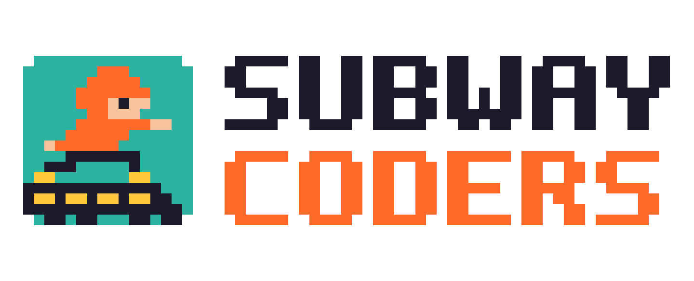

<p align="center">
  <picture>
    <source media="(prefers-color-scheme: dark)" srcset="branding/png/subway-coders-logo-dark.png">
    
  </picture>
</p>

<p align="center">
  <a href="https://plugins.jetbrains.com/plugin/32509"></a>
  <a href="https://plugins.jetbrains.com/plugin/32509"></a>
</p>

# Subway Coders

Subway Surfers gameplay in your IDE. Started as a joke, now I actually keep it open.

There's a player on each edge of the IDE. Pick a category (Subway Surfers, Temple Run, Minecraft
parkour, ...), or paste your own YouTube or video link. There's also a Doomscroll mode that just
loads YouTube Shorts.

If you use Claude Code, the videos get hidden and the terminal is focused when Claude needs an
answer. You can turn that off in the gear menu.

## Install

Search for "Subway Coders" in Settings > Plugins > Marketplace, or get it
[here](https://plugins.jetbrains.com/plugin/32509).

## Your own clips

Gear menu > Edit Config opens `categories.json`. Add your links, save, hit Shuffle.

```json
{
  "categories": [
    { "name": "Minecraft Story", "clips": ["https://youtu.be/n_Dv4JMiwK8"] }
  ]
}
```

## Building

Needs JDK 21.

```
./gradlew runIde
./gradlew buildPlugin
```

## License

[MIT](LICENSE)
